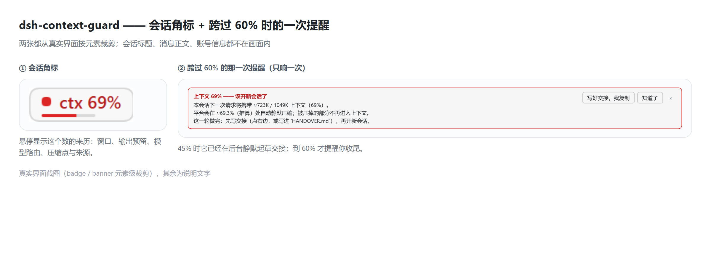

# dsh-context-guard

npm package: **`@2jumpsina/dsh-context-guard`** · [中文](README.zh.md)

A [DeepSeek Harness](https://deepseek-harness.github.io/deepseek-harness/guide/quickstart) plugin that **tells you to wrap up and start a new session before the session gets too long**.

It consumes the `contextPressure` projection that the official `dsh-token-meter` has already computed, and **after a turn has ended** it speaks up on two thresholds: "write the handoff into a document first, then start a new session." It then helps turn that sentence **into an action** — once the threshold is crossed it drafts a handoff block into the session working directory.

**Context tax = 0**: it registers no model-facing tool, injects no prompt section, and sends no extra request. The host does the arithmetic, the UI does the talking.

> 🆕 **Current release is live on npm `latest` (0.7.x)**: 45% silently drafts the handoff, 60% is the only reminder;
> the compaction point shows up in the badge tooltip and in the banner body (computed live as
> `min(window×0.8, window − reserve − 64K)`, with its source; marked "estimated" when the platform's
> compaction config is unreadable); and the moment the platform compacts, the pre-compaction reading is
> captured into the **compaction ledger** inside `HANDOVER.md`.
> Since v0.5.0 the **WeChat push** and **cross-session trend** are gone (their config keys retired from the
> schema in v0.7.2; leftover values in old profiles are ignored safely). See `HANDOVER.md` §46–§48.

> ⚠️ **Do not run `npm i dsh-context-guard`** — that unscoped name is a **third party's** package
> (by `greenlv`). This plugin's name is scoped: **`@2jumpsina/dsh-context-guard`**, published on npm
> (see [Install](#install)).

> 🙂 **Got it running? Send me a line — what I want most is to hear what could be better.**
> [One line is enough](https://github.com/2JumpSinA/dsh-context-guard/issues/new/choose): what it got right in your setup, and what felt off.




---

## ⚠️ It writes to your working directory (read this before installing)

- **On by default** (`handoverOnWarn: true`). When a session's occupancy crosses `warnRatio` (default 45%), the plugin creates/rewrites `handoverPath` (default `HANDOVER.md`) in **that session's working directory**, and then refreshes it every further 5 percentage points.
- What it writes are **machine facts**: session id, title, working directory, occupancy, turn/call counts, **ledger cost**, **the files this session wrote**, **previews of the last few prompts and replies**, plus empty "to be filled in" slots for the agent.
  ⇒ **It may contain sensitive content** (file paths, fragments of your questions and replies), and **it may end up committed by git**.
- Suggestions: add `HANDOVER.md` to your `.gitignore`; or point `handoverPath` at a location **outside any repository**; or simply set `handoverOnWarn: false`.
- Boundaries: a missing parent directory is refused; an existing target that is not a text file (`.json`/`.yml`/…) is refused; a **symlink** pointing elsewhere is refused; writes are atomic (temp file + rename) with tight permissions (`0o600`). Any failure is recorded as status only — it **never affects** the badge, the banner, or the push.

## Why this plugin has to exist

**In one line**: a long session is not a technical failure, it is a **bill that grows every turn**. This plugin
exists to put that bill in front of you at the one moment you can still act on it — after a turn has ended and
before the next request goes out.

### The problem is measurable

Cost ≈ (average prompt size) × (number of calls) × (unit price). A long session pushes the first two factors up
**at the same time**, and the unit price itself rises with occupancy. Measured against the ledger of the machine
this plugin was calibrated on (its local session-projection cache: **84 sessions / 14 days**, ¥252.29
self-reported) and the official DeepSeek pricing table:

| Measurement | Value |
|---|---|
| Self-check (price table × `contextTimeline.cost`, against the ledger total) | ¥254.29 vs ¥252.29 ⇒ **0.8% deviation**; per-request rows cover 85.4% of the total |
| Unit price by occupancy | **¥0.011/call** at 0–10% → **¥0.045/call** at 70–80% (**4.2×**) |
| Where the historical spend sits | calls at **≥40%** occupancy: **37.4%** of spend · at **≥60%**: **20.0%** |
| Session peaks | Observed **75/75 sessions never exceed ~80%**; the real point comes from the formula (≈ **67.8%** on this machine's deepseek-flash) |
| Interruption cost, if the line is drawn at 40% / 50% / 60% | **0.78 / 0.57 / 0.50** prompts per day |

And one real session, from the very repository this plugin was built in: **584 calls, 274M tokens, ¥31.66 — of
which 98.6% was re-reading context and 0.17% was model output.** That is the failure shape being addressed here:
no crash, no error message, just an invoice.

### Why this guard is the cheap half of the trade

The formula above has a shape worth spelling out. A session's total is

```
total ≈ Σ over turns ( prompt_i × unit_price(occupancy_i) )
```

and both factors move the **same way**: `prompt_i` grows monotonically with every turn, and the unit price
itself rises with occupancy (measured above: **¥0.011/call at 0–10% → ¥0.045/call at 70–80%**). A session
therefore does not get linearly more expensive as it runs, it gets **super-linearly** more expensive —
which is why the last third of a long session can cost far more than the first third while containing the
same number of turns.

That is the entire reason this plugin is worth installing: **its marginal cost is exactly zero.**

- It registers no model-facing tool, injects no prompt section, and sends no extra request ⇒ **it adds no
  tokens to any request** — it does not appear in the ledger at all.
- The only thing it ever costs you is the handoff at the end, and that handoff is not a fee paid to this
  plugin: it is work you would have to do anyway, usually worse (from memory, after the session has
  already been abandoned).
- It speaks **at the turn boundary**. A warning inside a turn is useless — that prompt is already on the
  wire and already paid for; a warning two turns later is an invoice you can no longer avoid.

So the trade is not "spend money to save money". It is: **put a free readout on a bill you are already
paying**, at the only moment when the number can still change the decision.

### Why nothing else already catches it

- **The platform compacts; it does not negotiate.** The automatic point is `min(window × 0.8, window − reservedOutput − 65,536)`
  (≈ **67.8%** on this machine's deepseek-flash), and it fires without asking. Compaction is a safety net for the session, not a warning to you — by
  the time it fires you have already paid for the whole climb. Since v0.6.1 the hard-tier banner prints that point
  explicitly; what it compresses away is gone — the only trace is a ledger row if one was written (the wording
  deliberately does not claim "the reading is lost forever").
- **The model cannot be the meter.** `projectedTokens` is computed by `dsh-token-meter` from the real request;
  the model cannot see how large its own prompt is, and a warning is only meaningful **after** a turn ends (that
  turn's prompt is already on the wire). Worse, any mechanism that makes the model "mind the context" has to
  inject a prompt section or register a tool — that is adding context tax to solve a context-tax problem.
- **You have no readout.** Occupancy is observable, but "time to wrap up" is not one reading: it needs
  hysteresis, a cooldown, edge triggering, cross-session counting, and it has to fire when you *open* an
  already-full historical session. Nobody watches a percentage while working.

### What it does instead — and deliberately does not

- **Context tax = 0**: no model-facing tool, no prompt injection, no extra request. A guard against context bloat
  must not itself consume context.
- **It only consumes what the official meter already computed** — it does not re-measure, estimate or guess.
- **It speaks once per level, at the end of a turn**: two levels + hysteresis + edge trigger + cooldown.
- **fail-closed**: with no denominator it does not judge at all, and the badge shows `ctx —` instead of 0%.
- **It turns the sentence into an action**: crossing `warnRatio` drafts a machine-facts handoff block (session,
  occupancy, ledger cost, the files this session wrote, previews of the last few prompts/replies, plus
  "to be filled in" slots) into the session working directory — zero LLM, zero extra request.
- **No network at all** (v0.5.0 removed the WeChat push); capabilities are `fs-read` / `fs-write` only.

### What this section does *not* claim

- **The savings are a counterfactual upper bound, not a promise.** Replaying this machine's ledger: the 2741
  calls made at ≥40% occupancy would have saved **¥59 (23%)** had they happened at 0–20%; the ≥60% batch would
  have saved **¥34 (14%)**. Wrapping up is not free — it costs exactly one handoff. The only claim is that this
  decision is better made with the number in front of you.
- **The thresholds are a calibration, not an optimum.** 0.45 / 0.60 come from those 84 sessions; they are
  defaults, and every one of them is configurable.
- **The sample is one machine, one provider, two weeks.** Prices and compaction behaviour change.
- **It does not judge whether your task is worth finishing.** It says one thing: continuing from here costs
  several times more per turn than starting fresh — and here is the handoff draft.

## What it does

| Half | What it does |
|---|---|
| **host** (`lib/index.js`) | Subscribes to `ctx.sessionProjections.onChanged` and feeds `contextPressure` to the pure policy; settles each turn on `turn/end`; owns the settings; judges once immediately on `session/created` (new **or** restored from storage); folds `compaction/end` and `request/header` into the decision; registers the verdict as the **`contextGuard` wire projection** for the browser half; registers `GET /api/context-guard/state` (a read-only debug mirror); extrapolates the verdict to WeChat when configured; and **drafts the handoff block** when a threshold is crossed |
| **client** (`lib/client.js`, a hand-written single-file bundle) | Session-header **badge** (live occupancy; numbers only, never speaks) plus a **one-shot banner** on threshold crossing (ratio + next step + pointer to the handoff document); level/turn/cooldown come **only** from `useProjection("contextGuard")` — read-only, no local state machine, no thresholds, no extra requests (see the Architecture section below) |

Behaviour notes:

- **Judgement timing = on projection change (not `turn/end`)**: `contextPressure` updates after every
  request and the plugin judges right then; `turn/end` only advances the turn counter and decays the
  cooldown, while `compaction/end` and `request/header` feed the decision.
  ⚠️ Earlier revisions here claimed "never mid-turn", which did not match the implementation. After the
  2026-10-17 code review the decision was **keep the implementation, fix the docs**: moving judgement to
  `turn/end` means that if that event is ever missed the plugin goes completely silent (a miss), while
  judging on projection change at worst warns slightly early. See `HANDOVER.md` §33.
- **Speaks once**: two levels + hysteresis (re-armed only after falling back below `warn − hysteresis`) + edge triggering + a cooldown of N turns.
- **At a level crossing you get two choices**: `Write the handoff, I will copy it` (write one machine-facts draft right away and surface a copy-ready opening line) and `Got it` (just close, no side effect).
- **fail-closed**: with no denominator (`contextWindow` absent) it does not judge at all, and the badge explicitly shows `ctx —` instead of pretending to be 0%.

## Architecture (v0.4.3): the host judges, the browser only reads (one decision)

One place decides, one place displays, and a single `wire` projection links them:

| Layer | Where | Responsibility |
|---|---|---|
| **Decision** | `lib/engine.mjs` (**host only**) | The state machine is a pure fold (`init` + `apply(state, event)`): level / armed / turn / cooldown / hysteresis are computed once, and `compaction/*` folds into that state |
| **Projection** | `lib/index.js` (host) | Registers the verdict as the **`contextGuard`** `wire` projection: `{ level, armed, turn, cooldown, ratio }` — flat JSON, same reference while unchanged |
| **Display** | `lib/client-source.js` (browser) | `useProjection("contextGuard")`, **read-only** (badge + one-shot banner); no thresholds, no state machine, no extra requests |
| **Debug mirror** | `GET /api/context-guard/state` | A read-only mirror: current host config / recent decisions / ledger counters / handoff stats. The browser half **no longer** copies thresholds from it |

Two things this buys:

- **One decision.** The browser half used to carry its own state machine and copy the thresholds from
  the state route on boot ⇒ two cooldowns, two hysteresis rules, and `settleTurn` wired to a banner
  button (one click could advance the turn counter client-side). The decision now lives only in
  `lib/engine.mjs` and is not even in the bundle — structurally: `test/client-sync.test.mjs` also
  statically bans the `hostSync` / `setConfig` / `settleTurn` identifiers.
- **It shows what it was told.** The debug surface `window.__DSH_CONTEXT_GUARD__.store.dump()` (all
  sessions) and `viewOf(sessionId)` (one) records **what the host projection said**, not what the
  client computed. When the projection is absent (older host / no token-meter), the badge still shows
  occupancy but **no banner appears** — better to stay quiet than to reintroduce a second judge.

## Install

> ⚠️ **Do not run `npm i dsh-context-guard`.** The unscoped name
> `dsh-context-guard` belongs to a **third party** (`greenlv <lgr5945@gmail.com>`; latest `0.2.1`, now
> deprecated in favour of `dsh-completion-guard`). That command installs **their** plugin, not this one.
> This plugin's name is scoped — **`@2jumpsina/dsh-context-guard`** — and is published on npm.

### Install into DSH (recommended)

`dsh plugin` is a thin wrapper around pnpm: it runs package management **inside the profile** and then
registers the new bundle. One command, everything else is automatic:

```powershell
dsh plugin --profile web add @2jumpsina/dsh-context-guard
```

What DSH does for you afterwards (all verified on a live profile): adds the dependency to the
profile's `package.json` · appends the package to `dsh.profile.bundles` — that is what makes it an
actual profile layer · applies the package's `cordis.patch.yml` to mount the host half, and its
`dsh.client` declaration to inject the browser half.

⚠️ **Restart dsh afterwards.** Source changes do not hot-reload, and a newly installed layer is
applied at boot.

Installing the package is *not* the same as mounting it — `npm i` alone only puts files in
`node_modules` and changes no profile.

### Install from this repository instead

```powershell
dsh plugin --profile web add git+ssh://git@github.com/2JumpSinA/dsh-context-guard.git
```

Requires `git` on PATH and a GitHub SSH key. ⛔ The `github:` shorthand
(`dsh plugin --profile web add github:2JumpSinA/dsh-context-guard`) resolves to an **HTTPS** clone,
which is unreliable on some networks (it fails with a confusing git error and no hint about
transport) — prefer the `git+ssh://` form or the npm package above.

### Plain npm (no DSH underneath)

If you are only fetching files and mounting them yourself:

```bash
npm i @2jumpsina/dsh-context-guard
```

**During local development** (not published, mounted into a profile with a junction) this is also common:

```powershell
# junction the repo into the target profile's node_modules (replace the paths for your environment)
New-Item -ItemType Junction `
  -Path   $env:DSH_HOME\profiles\<profile>\node_modules\@2jumpsina\dsh-context-guard `
  -Target <repo path>
```

Then append an `insert` entry to that profile's `cordis.patch.yml` (the user patch layer):

```yaml
- insert:
    - id: context-guard
      name: '@2jumpsina/dsh-context-guard'
```

> ⚠️ Do not put this package into the profile's `dsh.profile.bundles` — that fails with `cannot resolve profile bundle`.
> ⚠️ With a junction, Node resolves `node_modules` upward from the **real path** ⇒ the repo needs its own dependencies (or let DSH resolve them from the install location).

## Configuration

Editable on the settings page, all applied live; every `config` field is volatile ⇒ changing them needs **no restart** (changing **source**, however, does — see below).

| Field | Default | Range | Meaning |
|---|---|---|---|
| `enabled` | `true` | bool | Master switch |
| `locale` | `auto` | `auto`\|`zh`\|`en` | Copy language; `auto` is resolved per half (the host reads the session's first input, the browser reads `navigator.language`, both fall back to Chinese). ⚠️ This field only affects the **host side** (handoff draft / host logs / push); the browser side is forced by the pre-load escape hatch only — see [Language](#language) |
| `warnRatio` | `0.45` | 0.1–0.95 | Occupancy (`projectedTokens / contextWindow`) at which "time to wrap up" fires |
| `hardRatio` | `0.60` | 0.1–1 | "Time to start a new session"; must be > `warnRatio` |
| `hysteresisRatio` | `0.05` | 0–0.2 | Hysteresis: re-arm only after falling back below `warn − this value` |
| `cooldownTurns` ~ | `5` | 0–100 | **no-op since v0.7.1**: the cooldown gate was removed (a crossing already speaks once per arming cycle) |
| `onResume` | `true` | bool | Also warn when entering an already-high historical session |
| `respectCompaction` | `true` | bool | **Host log only**: skip the decision log entry right after a compaction; the badge/banner still reflect the real level |
| `handoverOnWarn` | `true` | bool | Auto-draft the handoff block once `warnRatio` is crossed |
| `handoverPath` | `HANDOVER.md` | string | Relative to the **session working directory**, or an absolute path |
| `handoverRefreshPercent` | `5` | 1–25 | Refresh the draft every additional N percentage points of occupancy |
| `handoverTurns` | `6` | 1–20 | How many "prompt / reply" previews the draft carries |
| `handoverFiles` | `12` | 1–50 | How many recently written files the draft carries |

> The schema floor for `warnRatio` is **0.1**: a value like `0.05` stops the entire plugin from mounting
> (`ValidationError: invalid config: $.warnRatio expected number >= 0.1`, and the state route then 404s).

## Language

All user-visible copy is bilingual (Chinese + English): the banner, the handoff draft, host logs and
the badge/banner UI text. Default is `auto`, and the two halves resolve it **separately** — they do not
look at the same clues:

| Half | What `auto` looks at | Fallback |
|---|---|---|
| Browser (badge tooltip + banner) | the **pre-load** escape hatch `window.__DSH_CONTEXT_GUARD__.config.locale` > `navigator.language` (`zh…` ⇒ Chinese, anything else ⇒ English) | Chinese |
| Host (handoff draft + logs + push) | whether that session's **first user input** contains Chinese characters (`titleInput`, read from the projection registry's host state via `stateOf`) | Chinese |

- **Browser-side language = pre-load escape hatch `config.locale` > `navigator.language` > `zh`.** The
  hatch has to be injected **before the bundle loads** (`addInitScript` and friends): the language is
  frozen at module-evaluation time. It is absent by default ⇒ `auto` almost always follows the browser
  language.
- **The host-side `locale` only affects the host's own surfaces** (handoff draft, host logs). Since v0.4.3 the browser half **no longer** reads the language from the host
  (that `GET /state` path is gone), so "set `locale: 'zh'` and both halves speak Chinese" **no longer
  holds** — forcing the browser side is only possible through the **pre-load** hatch above.
- **Settings-page field descriptions** are always written as `English / 中文` in one line: the DSH config
  schema is static load-time metadata with no per-locale description mechanism, and the settings page
  has no idea which session you are looking at. (If DSH ever grows per-locale descriptions, those
  strings move into the string table and this note goes away.)
- **Escape hatch**: when there is no session to look at (startup logs, settings page, the state route),
  the host half reads `DSH_CONTEXT_GUARD_LOCALE=zh|en`; any other value is ignored.
- Machine-facing surfaces stay English in every language: JSON keys on the state route, config field
  names, and log `code`s. Only sentences meant for humans get translated.
- The sample draft block further down is what a **Chinese** session produces; an English session renders
  the same structure with English labels.

## Host state route

`GET /api/context-guard/state` — a **read-only debug mirror**: it shows the host's current decision settings and counters to `curl`, a troubleshooting session, or the acceptance scripts.
⚠️ Since v0.4.3 the browser half **no longer** takes its data from here (level/cooldown come over the `contextGuard` projection — see Architecture). Breaking this route therefore cannot break the badge or the banner, but it does cost you one pair of eyes.

```jsonc
{
  "plugin": "context-guard",
  "at": 1790000000000,
  "config": { /* the table above; handoverPath returns a relative/file name only, never an absolute path */ },
  "recent": [ { "sessionId": "…", "level": "warn|hard", "ratioPercent": 52, "title": "…", "body": "…" } ],
  "ledger": { "written": 1, "failed": 0, "unchanged": 0,
              "last": { "at": 1790000000000, "status": "appended", "row": 1 } },
  "handover": { "enabled": true, "path": "HANDOVER.md", "refreshPercent": 5,
                "written": 1, "failed": 0, "skipped": 0,
                "last": { "status": "appended|replaced|error|skipped", "path": "HANDOVER.md", "bytes": 1234, "error": null },
                "history": [] }
}
```

## Automatic handoff draft

When `warnRatio` is crossed (or a session already above it is opened), the plugin maintains a **marked** draft block in the session working directory:

```markdown
<!-- dsh-context-guard:begin session-… -->
### 🤖 自动交接草稿（dsh-context-guard · 时间 · 占用 52%）
… 机器事实表格 · 改过的文件 · 最近几轮摘要 · 「待补」空槽 …
<!-- dsh-context-guard:end -->
```

(The block's labels are Chinese because that is what the plugin writes today — the facts themselves are language-neutral: a machine-facts table, the files changed, the last few turns, and empty slots.)

- **Idempotent**: one block per session, replaced wholesale on refresh, **never appended twice**; a human can delete the whole block.
- **You can also trigger it by hand (v0.3.5)**: the banner button `Write the handoff, I will copy it` issues `POST /api/context-guard/draft`, which **skips the "only refresh after another step" gate**, writes the block right away, and returns a copy-ready opener:
  `@HANDOVER.md Continue from this handoff. Fill in the "to fill in" slots first, then carry on with the task.`
  (Like the state route, this route has **no plugin-level authentication**: the response carries a file name only, never an absolute path.)
- **Machine facts only, no conclusions** — the plugin has no idea what you did. Have your agent fill in the conclusions / pitfalls / next steps in the "to be filled in" slots, or fold the block into your own handoff document and delete it.
- **Where the material comes from (verified on a live machine 2026-09-30; fixed in 0.3.2 — the first version published under the `@2jumpsina` scope)**: the machine facts come from the **host state source of truth** — the registry's `sessionProjections.stateOf(session, key)` — and **not** from the **wire view** pushed by projection changes.
  Why: once the on-demand detail channel is armed, the wire view of `contextTimeline` (registered by plugins such as `dsh-context`) is a **slim head**: occupancy, size, tool mix and cost are all there, but **`fileOps` is not** — the heavy collections exist only in the unit state. v0.3.0 read the wire view only ⇒ "files changed" was always 0 (**identical for a restored session and a running one**; it was never a difference between those two paths); and `turnOutline`'s wire view is an **array** while v0.3.0 read `{turns}` ⇒ "last few turns" always printed "host did not provide". Both are fixed now, each guarded by unit tests and the self-test.
- **Dependencies and degradation**: `fileOps` and the tool mix depend on a plugin that registers `contextTimeline` (e.g. `dsh-context`); cost depends on `tokenCost` (e.g. `dsh-damage-pulse`). When they are absent, those sections render empty — the plugin **invents nothing** and does not fail. And if the host registry has no `stateOf` (older harness), it falls back to the wire view, i.e. v0.3.0 behaviour.

### How faithful is the handoff? (v0.3.6 — this section matters more than the feature list)

| What | Fidelity | Why |
|---|---|---|
| session / occupancy / spend / changed files / time | **high (verifiable)** | all of it comes from official projections; the plugin neither rewrites nor estimates. If a number is wrong, the projection is wrong — not the prose |
| **the last N turns summary** | **medium (truncated)** | it is a condensed "prompt / response" list, not the original text ⇒ treat it as a **clue**, not as evidence |
| **to fill in (conclusions / pitfalls / next steps)** | **empty** | the plugin has no idea what you did. Those three slots belong to whoever **saw the whole conversation** — you, or the old session's agent |

Two consequences worth stating plainly:

1. **A new-session agent that only sees the summary will *infer*.** It never saw the failed attempts, the rejected
   approaches or the verbal agreements in those dozens of turns ⇒ read its conclusions as a **draft** and correct them.
2. **The old session's agent writes better conclusions** (it still has the context). The button covers the zero-cost
   machine facts; for conclusions, ask the old session for one line and write them **outside** the block.

> **Manual notes now survive refreshes (v0.3.6)**: the "to fill in" area has its own sub-markers
> `<!-- dsh-context-guard:todo:begin/end -->`; a refresh updates **only the machine facts above it** and leaves the
> manual content byte-for-byte intact. (Blocks written by ≤0.3.5 have no sub-markers and are rescued once via a
> `- [ ]` line anchor.)

## Thresholds and the reasoning behind them (why 0.45 / 0.60)

- **Occupancy = `projectedTokens / contextWindow`** (the official definition: how large the **next** request's prompt is, output excluded). Always a ratio: switch models and the window switches with it.
- **Cost rises with occupancy**: fitting per-call cost against occupancy using official pricing, a call in the high band costs several times one in an empty session; wrapping up later costs more, and starting a new session earlier saves more at the price of exactly one handoff (so keep it short).
- **The 0.60 hard line deliberately precedes the platform's own move**: the automatic compaction point is **not a fixed 80%** but
  `min(window × 0.8, window − reservedOutput − 65,536)`. On this machine's deepseek-flash (1,000,000 window / 256,000 output reserve) that is
  **67.8%** (678,464 tokens) — matching what the real machine does. Putting hard at that point would race it for the same moment, and
  `respectCompaction: true` (host-log only since v0.7.1) would keep the **host** silent right after a compaction ⇒ host decisions and the
  UI could drift apart, which is why hard still sits before the compaction point.
- **Speaking the truth (v0.6.1)**: the hard-tier body prints the threshold **computed on this machine with the same formula** (e.g. "about 67.8%");
  when the window or the output reserve is unknown it prints **no number** and only says "the platform silently compacts".
  The wording deliberately does not claim "the reading is lost forever" — the ledger keeps a row (if one was written).
- **v0.6.12: universality boundary (it adapts to machine and model, with one unreadable input).**
  The window comes from `contextPressure.contextWindow`, the output reserve from `request/header.config.maxTokens`
  (falling back to the adapter's `defaultMaxTokens`) — **both are read at runtime, per session and per route**, so a
  different machine or model is picked up automatically. But `dsh-compaction-basic`'s `thresholdRatio` (0.8) /
  `headroomTokens` (65,536) / `modelPolicies` live on a **per-agent-leaf service that a third-party plugin cannot read**
  (verified: neither root-context injection nor the agent's scoped context exposes it), so the point is computed from
  **factory defaults** — if you override those three in your profile, this plugin's number will be **off**. The copy
  therefore always says "estimated" and names the source; it never claims exactness. The badge tooltip also shows the
  environment (`provider/model` · agent preset).
- Division of labour (v0.6.3): `warnRatio` (0.45) = **draft the handoff silently**, no banner any more;
  `hardRatio` (0.60) = the **only reminder** (shown once when crossed, until you dismiss it).

## Compaction ledger (v0.5.0)

After the platform compacts, **the pre-compaction reading is gone for good** (the platform eats its own evidence). On `compaction/end` the plugin appends one row to a ledger inside the working directory's `HANDOVER.md`, in its own marker block, so a draft refresh can never overwrite it:

```markdown
<!-- dsh-context-guard:ledger:begin -->
### 🗜️ Compaction ledger (appended automatically, do not edit)

| # | time | session | peak before | size | total spend | files | event |
|---|---|---|---|---|---|---|---|
| 1 | 2026-10-19 15:42 | a4b6cffb | 79.8% | ≈160K/1000K | ¥1.84 | 5 | 7f19c0a1 |
<!-- dsh-context-guard:ledger:end -->
```

Three invariants: **idempotent by `compactionId`** (a repeated delivery writes one row), **peak before compaction** (not the lower value afterwards), and **failures are never silent** (a failed write shows up in `/state.ledger.failed`). After a compaction the banner's degraded state adds one receipt line: "before compaction 79.8% · ledger row 1 · now 20%".

> It is **decoupled from `handoverOnWarn`**: turning off auto-drafting turns off prompts, not the record.

## Security and privacy

- **The state route has no plugin-level authentication**: it is registered on the host webServer (the same access control as DSH Web). What the plugin does defend is: **relative/file names only** (never a local absolute path), `Cache-Control: no-store`, and no CORS headers. Do **not** expose DSH Web on `0.0.0.0`.
- **The side effect of writing files** is the warning at the top; the write path comes from your own settings, never from remote input.
- **The browser half's debug handle** `window.__DSH_CONTEXT_GUARD__` is **read-only** since v0.4.3: `store.dump()`, `viewOf()` and a `config` getter, **no `override()`**. `Object.defineProperty` pins it so it cannot be replaced wholesale. It is available inside the page only and grants no privilege (that code already runs in your DSH Web page).
- The plugin does not use the network, does not call any LLM, and does not send session content (v0.5.0 removed the WeChat push entirely).

## Tests and local acceptance

```bash
npm test          # unit tests + the "bundle is byte-identical to source" check
npm run build     # regenerate lib/client.js (required after changing lib/client-source.js or lib/policy.mjs)
```

Requires Node `^22.19.0 || >=24.0.0`.

## Troubleshooting (every one of these was hit for real; written down so they are not repeated)

1. **A `.volatile()` field is a reference, not a value**: reading `config.warnRatio` inside `apply(ctx, config)` is always `undefined` ⇒ it silently falls back to the default. Read each field as `isVolatile(v) ? v.get() : v` (see `plainConfig()` in `lib/policy.mjs`). That is how the settings page can show 0.33 while the plugin judges at 0.45.
2. **Source edits do not self-heal**: a running instance neither re-reads the profile's `cordis.patch.yml` nor reloads already-mounted modules ⇒ after changing config or source, **restart that dsh process** (the browser half is the opposite: the server re-reads the bundle per request, so a page refresh is enough).
3. **`patchReload: live` is not a file watcher**: it governs that one composition, not hot reloading.
4. **With a junction install, Node resolves dependencies from the real path** ⇒ the repo needs its own `node_modules` (or let DSH resolve them from the install location).
5. **`--profile` is a top-level flag**: `dsh --profile <p> --port <n>` is correct; `dsh web --profile <p>` fails with `select a profile only once`.

## Uninstall

**If you installed it with `dsh plugin add`** (the normal path): one command — the bundle entry and the
dependency are reconciled away automatically — then **restart that dsh process**.

```powershell
dsh plugin --profile web remove @2jumpsina/dsh-context-guard
```

**If you mounted it by hand with a junction** (local development): delete that `insert` entry from the
profile's `cordis.patch.yml` (and any `- id: context-guard` config entry the settings page may have
written into the same file), remove the profile's `node_modules\@2jumpsina\dsh-context-guard`, then
**restart that dsh process**. (Remove a junction with `cmd /c rmdir` — that deletes the *link*, not
your repository.)

## License

[MIT](./LICENSE)
